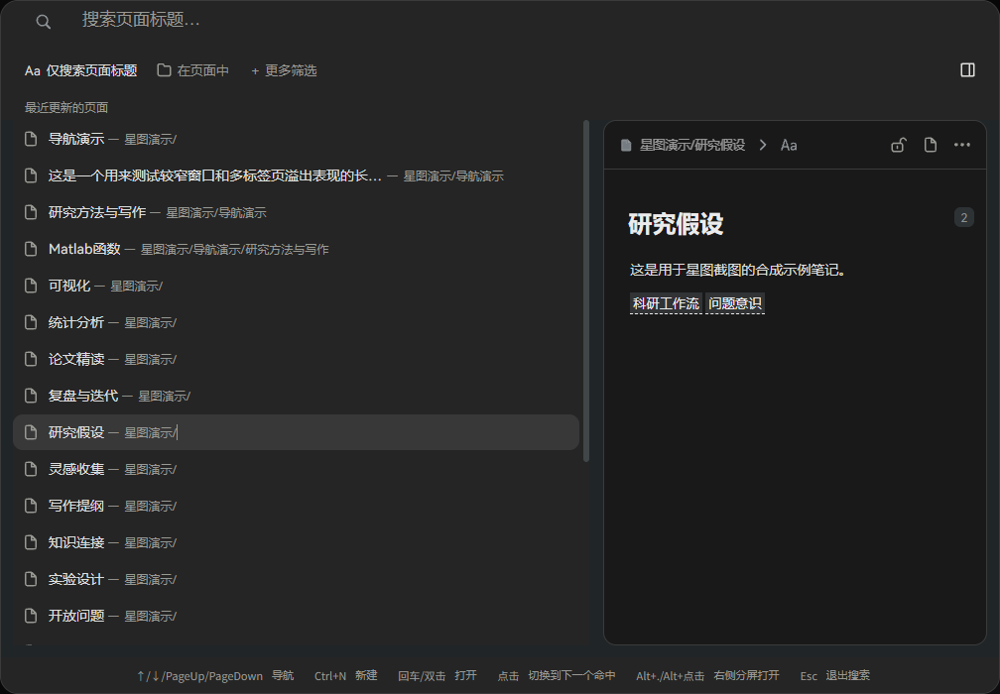
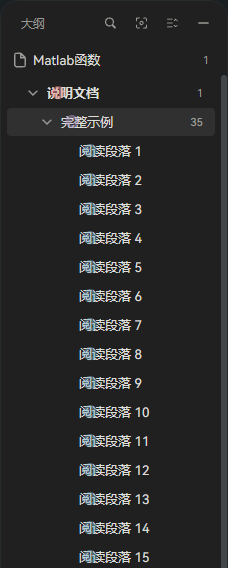

# Notion 风格界面

让思源常用的导航、文档树、大纲和搜索窗口更简洁。支持浅色和深色模式，三个区域可独立开启。

免费开源，采用 MIT 许可证。适用于思源 3.8.7 及以上版本的桌面端和桌面浏览器。介绍中的截图均来自隔离工作空间的示例笔记。

## 选择外观

在思源「设置 → 集市 → 已下载」中找到「Notion 风格界面」，打开插件设置。三个开关自动保存并立即生效；关闭某项会恢复当前主题及代码片段提供的外观。

## 文档树与搜索

- 文档树使用柔和的选中底色和统一行高，保留原生层级缩进；操作按钮在悬停或焦点进入时出现。
- 大纲去掉彩色标题等级徽标，保留折叠箭头和缩进；当前标题使用柔和的选中底色，点击跳转仍由思源处理。
- Ctrl+P 全局搜索采用紧凑的单行标题与路径，右侧显示独立预览卡片。
- 默认开启「仅搜索页面标题」。空输入显示最近更新的 40 个页面；关闭标题开关可恢复原生块搜索。标题模式适用于关键字和查询语法搜索。
- 「更多筛选」展开原生筛选、搜索方式、替换和查询条件。选择原生搜索类型时会退出标题模式。右侧按钮可隐藏预览；窄窗口自动隐藏预览。
- Ctrl+F 页内查找使用右上角 284 px 小浮层。输入后按 Enter / Shift+Enter 或上下箭头按钮定位匹配块；数量按思源的块计算，多页结果显示页码并支持继续翻页。点击「查找与替换」展开原生高级界面。
- 搜索页签及其他插件的搜索界面沿用原来的样式。
- 文档树和大纲只加载样式。搜索使用原生事件及只观察 body 直接子节点的对话框观察器；每次打开窗口最多一次限量、只读的最近页面查询。没有定时器、滚动监听或正文子树观察；关闭窗口取消未完成的请求。

## 导航与路径

- 保留原生标签页切换、关闭、固定、拖动、分屏和新建入口。
- 标签使用简洁的选中底色和左对齐标题；顶栏合并模式保留原生工具按钮与窗口控制区的预留空间，多标签可横向滚动。
- 保留原生前进/后退按钮及其位置，不复制按钮或转发点击。
- 面包屑将文档层级显示为独立按钮，点击任一级可打开对应文档；笔记本名称只作标识。原生文档图标、路径菜单、展开箭头、块级路径和聚焦操作保留。
- 不再插入自定义文档路径，也不隐藏原生面包屑。0.4.0/0.4.1 的路径替换方案已移除，以解决重复路径及交互冲突。
- 导航区域只注入 CSS，不增加事件订阅、DOM 观察器或路径请求。
- 在集市的「已下载」中停用插件即可恢复所有区域原来的外观。

适用于思源 3.8.7 桌面端与桌面浏览器，已在 Savor 6.4.3 和默认主题中验证。其他主题如覆盖相同导航区域，可能需要适配。

## 本地开发

修改 `navigation.css`、`tree.css`、`search.css`、`find.css` 或 `plugin.js`，运行 `node build.mjs`。将 `index.js`、`plugin.json`、`README.md`、`LICENSE`、`icon.png` 和 `docs/` 复制到工作空间的 `data/plugins/siyuan-notion-navigation/`，再启用插件。运行 `node qa/check-lifecycle.cjs` 检查生命周期与设置逻辑。

独立的外观插件，与 Notion 无关联。

## 0.4.3

- 标签标题统一为正体，展开原生文档按钮的路径文字。
- 全局搜索忽略旧窗口位置，以当前视口居中；不影响 Ctrl+F 页内查找的位置。

## 0.4.4

- 文档路径中的各级页面可分别点击，例如点击「研究生」直接打开该页面。只扩展文档层级，块级路径与原生工具继续由思源处理。

## 0.4.5

- 点击正文后，思源重绘原生面包屑时自动恢复已加载的分级按钮；不重复查询路径。

## 0.4.6

- 分级文档路径显示时收起后面的块级面包屑；退出聚焦和右侧文档操作仍使用思源原生按钮。关闭「导航栏与路径」可恢复完整原生块路径。

## 0.4.7

- 全局搜索按视口水平、垂直居中，避免思源或主题保存的弹窗位置使其贴顶；Ctrl+F 页内查找仍在右上角。

## 0.4.8

- 左右分屏或调整笔记区域宽度时，Ctrl+F 页内查找框会跟随当前笔记移动，不再停留在图谱等相邻面板上方。

## 0.4.9

- 修正 Savor 主题覆盖全局搜索栏的间距和圆角：输入行更紧凑，搜索图标、文字及清空按钮垂直居中。

## 0.4.10

- 大纲与文档树共用一个外观开关：去掉彩色 H1/H2 等级徽标，统一层级行高、悬停和选中样式；保留思源原生标题跳转、折叠与搜索。
